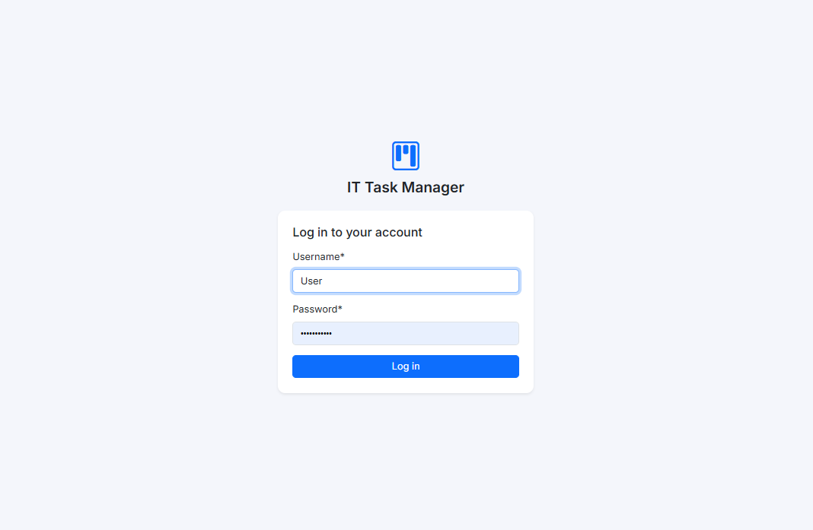
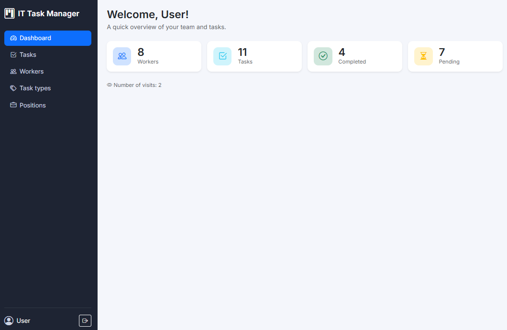
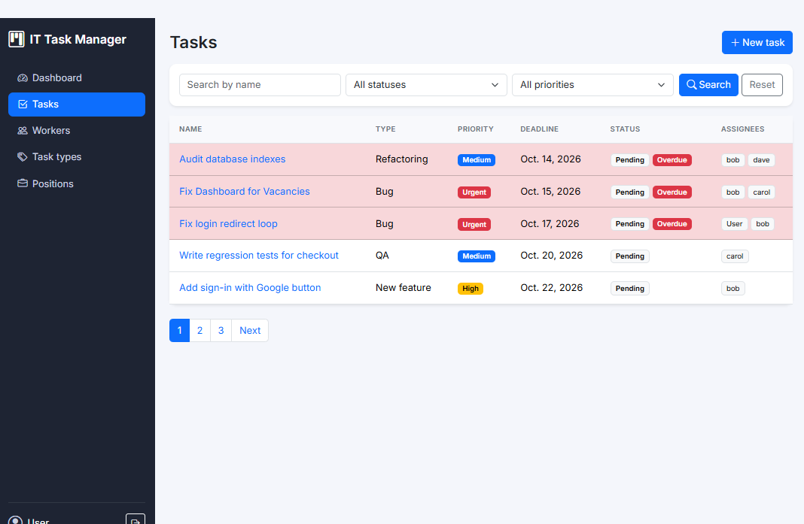
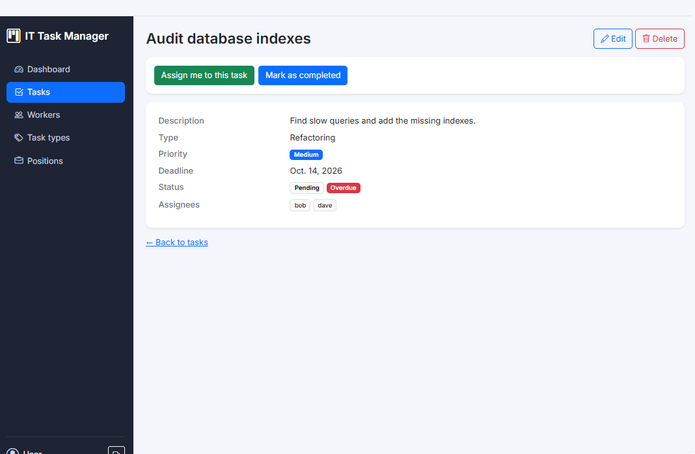
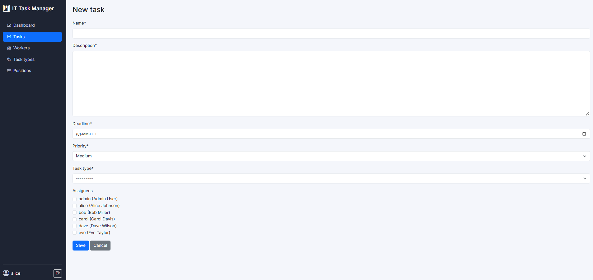
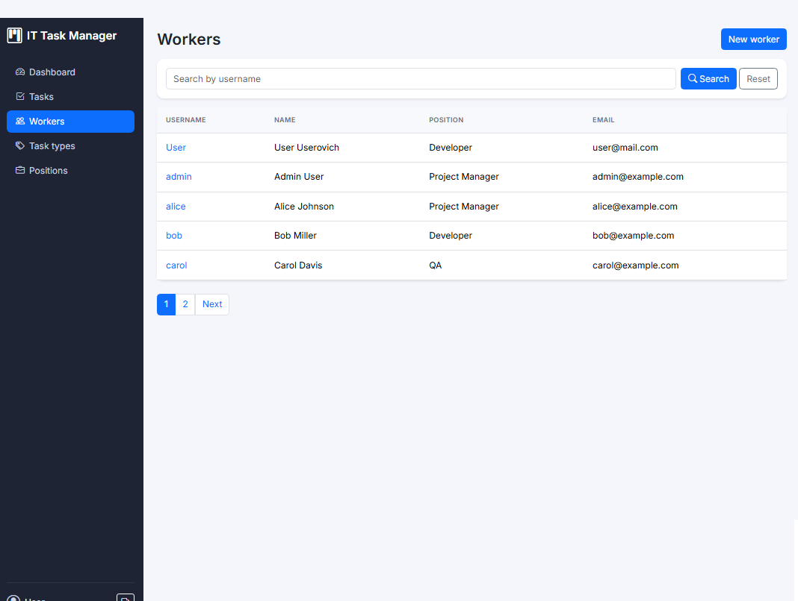
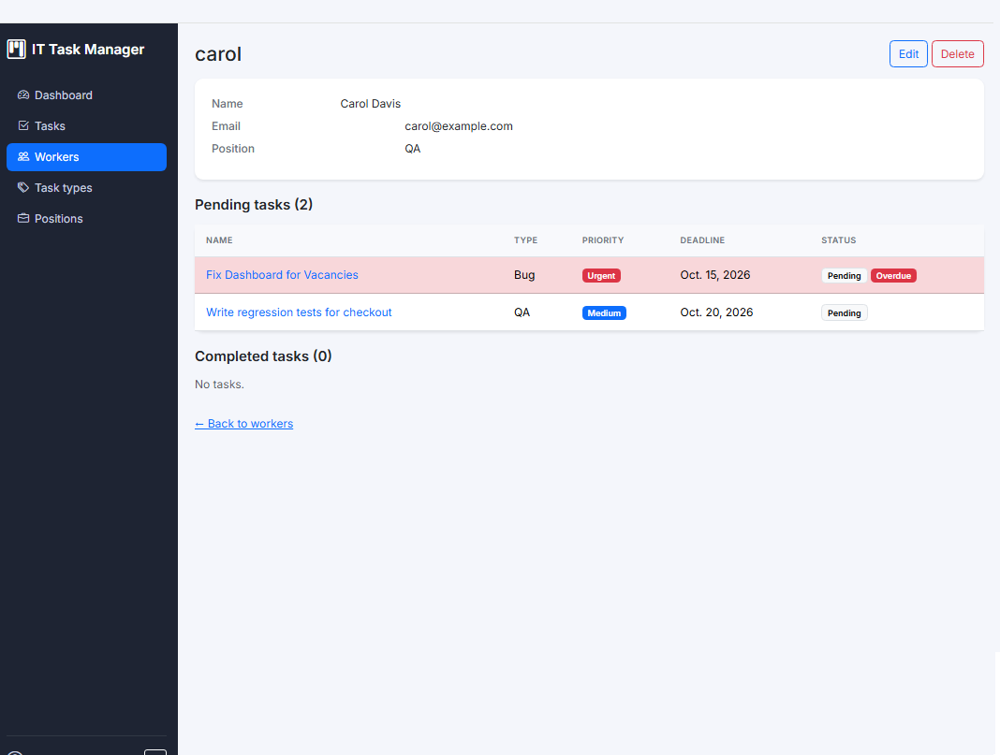
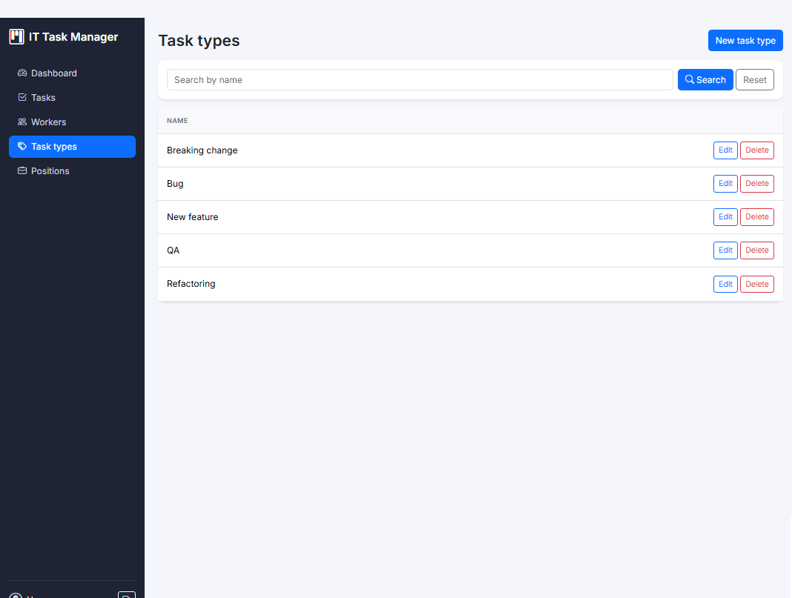
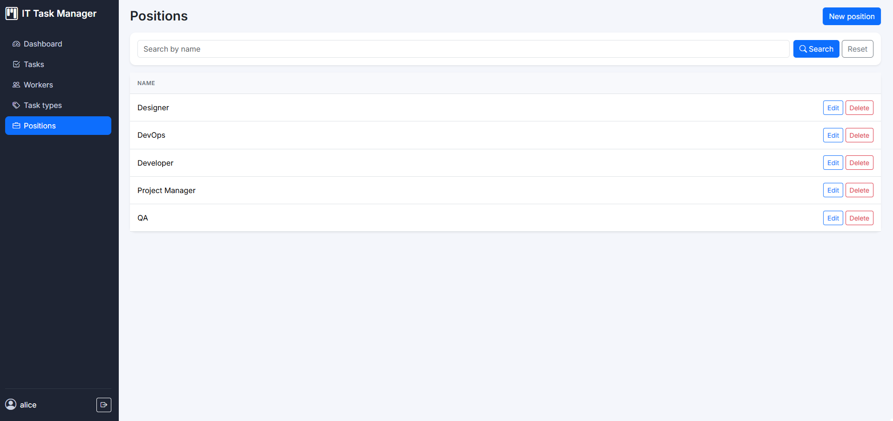
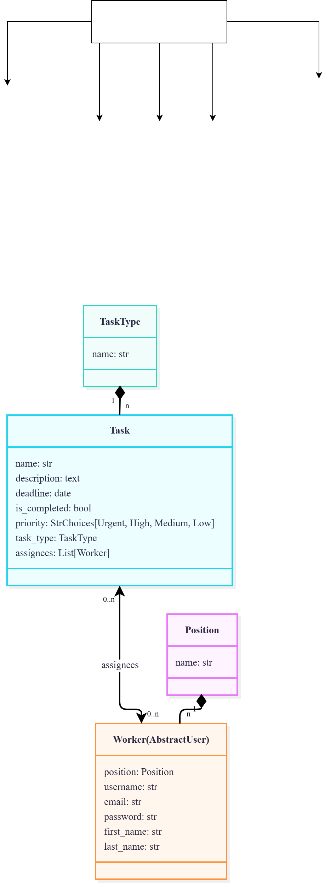

# IT Task Manager


A web application for IT companies where team members (developers, designers,
project managers, QA engineers, DevOps) create tasks, assign them to colleagues
and mark them as completed. The project is built with Django and Bootstrap 5.

## Features

- **Authentication**: login and logout; every page except the login page requires authentication.
- **Dashboard**: counters for workers, tasks, completed and pending tasks, plus a per-session visit counter.
- **Tasks**: list, detail, create, update and delete.
  - Priority badges (Urgent, High, Medium, Low) and a status badge.
  - Overdue tasks (deadline in the past, not completed) are highlighted.
  - Deadline validation: a new task cannot have a deadline earlier than today, and an existing deadline cannot be moved to the past.
  - Several assignees can be selected with checkboxes in the task form.
  - "Assign me to this task" / "Remove me from this task" button on the task page.
  - A button to toggle a task between completed and not completed.
- **Workers**: list, detail, create, update and delete. The detail page shows two separate lists: pending and completed tasks of the worker.
- **Task types** and **positions**: list, create, update and delete. Items that are still in use cannot be deleted, and a message is shown instead of an error page.
- **Search, filters and pagination** (5 items per page) on every list page:
  - tasks are searched by name and filtered by status and priority;
  - workers are searched by username;
  - task types and positions are searched by name;
  - search and filter parameters are preserved when switching pages.
- **Django admin** configured for all models, with a custom `UserAdmin` for `Worker` that includes the position field.
- **Query optimization**: `select_related` and `prefetch_related` on list pages to avoid N+1 queries.
- **Demo data** management command, **tests** with 100% coverage and a **GitHub Actions** workflow (flake8 and tests).
- Existing overdue tasks can still be edited as long as their deadline is not moved to a past date.

## Tech stack

- Python 3.14
- Django 5.2
- SQLite (development)
- Bootstrap 5 and Bootstrap Icons (via CDN)
- django-crispy-forms with crispy-bootstrap5
- flake8 (with flake8-quotes, flake8-variables-names and pep8-naming)
- coverage
- GitHub Actions

## Screenshots

> Add screenshots of the pages to `docs/screenshots/` and keep the links below.

| Page | Screenshot |
|------|------------|
| Login |  |
| Dashboard |  |
| Task list |  |
| Task detail |  |
| Task form |  |
| Worker list |  |
| Worker detail |  |
| Task types |  |
| Positions |  |

## Database schema



- `Position` 1 — n `Worker`
- `TaskType` 1 — n `Task`
- `Task` n — n `Worker` (field `assignees`)

## Installation

1. Clone the repository and open the project folder:

```bash
   git clone https://github.com/<your-username>/<repo-name>.git
   cd <repo-name>
```


2. Create and activate a virtual environment:

```bash
   python -m venv .venv
```

   Windows (PowerShell):

```powershell
   .venv\Scripts\Activate.ps1
```

   Linux / macOS:

```bash
   source .venv/bin/activate
```


3. Install the dependencies:

```bash
   pip install -r requirements.txt
```


4. Create the environment file and set your own secret key:

   Windows (PowerShell):

```powershell
   Copy-Item .env.example .env
```

   Linux / macOS:

```bash
   cp .env.example .env
```

   Generate a key and paste it into `.env` as the value of `SECRET_KEY`:

```bash
   python -c "from django.core.management.utils import get_random_secret_key; print(get_random_secret_key())"
```


5. Apply the migrations:

```bash
   python manage.py migrate
```


6. Load the demo data (positions, task types, workers and tasks):

```bash
   python manage.py load_demo_data
```


7. Run the development server:

```bash
   python manage.py runserver
```


8. Open http://127.0.0.1:8000/ and log in with one of the demo accounts below.

## Demo credentials

All demo accounts share the same password: `demo12345`.

| Username | Role in the demo | Notes |
|----------|------------------|-------|
| `admin` | Project Manager | Superuser, can also log in to `/admin/` |
| `alice` | Project Manager | |
| `bob` | Developer | |
| `carol` | QA | |
| `dave` | DevOps | |
| `eve` | Designer | |

These accounts are meant for local demonstration only.

## Running tests and checks

```bash
python manage.py test
coverage run manage.py test
coverage report -m
flake8
```

The same checks (flake8, missing migrations and tests with coverage) run on every push
and pull request through GitHub Actions (`.github/workflows/ci.yml`).

## Project structure

```text
it_task_manager/                     project settings and root URL configuration
catalog/
    management/commands/    load_demo_data command
    tests/                  tests for models, views, forms and the demo data command
    models.py               Position, TaskType, Worker, Task
    views.py                class-based views
    forms.py                task, worker and search forms
    urls.py                 app URLs
    admin.py                admin configuration
templates/                  base layouts, includes and per-entity templates
static/css/                 custom styles
docs/                       database schema and screenshots
```

## Notes

This is a development setup that uses SQLite. Before deploying to production,
switch to PostgreSQL, set `DEBUG=False`, generate a unique `SECRET_KEY` and
list your domain names in `ALLOWED_HOSTS` in the `.env` file.
